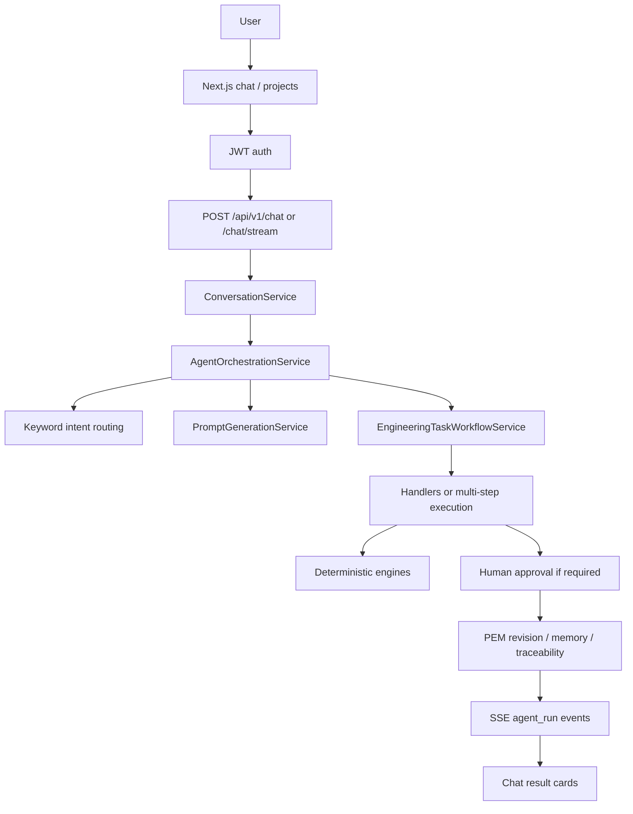

# SAAI capability audit

**Inspection only.** This document records what the current codebase can and cannot do. It is not a design spec. Placeholders, enums, empty dicts, TODOs, and “readiness” handlers are **not** treated as implemented unless executable logic exists.

**Date of inspection:** 2026-10-06 (codebase at inspection time).

**Overall product:** chat-first structural engineering workspace (register/login, projects, chat, files, Agent Builder, RC beam Demo). See [README.md](../README.md), [PRODUCT_BOUNDARIES.md](PRODUCT_BOUNDARIES.md), [AGENT_WORKSPACE.md](AGENT_WORKSPACE.md), [DEMO.md](DEMO.md). Top-level `agents/` and `engineering/` packages are **boundary stubs**; real logic lives in `backend/app/`.

**Classification legend**

| Mark | Meaning |
|------|---------|
| IMPLEMENTED | Executable and performs the named job |
| PARTIALLY IMPLEMENTED | Real code exists but is far short of the named job |
| NOT IMPLEMENTED | Missing, honesty-stub, or unused schema |
| IMPLEMENTED BUT UNVERIFIED | Adapter/path exists; local CSI/AutoCAD was not exercised in this inspection |

---

## A. Current end-to-end workflow

**Primary path:** UI (`frontend/components/chat/ChatWorkspace.tsx`, `frontend/hooks/useChat.ts`) → [`ConversationService`](../backend/app/application/conversation_service.py) → [`AgentRuntimeService`](../backend/app/application/agent_runtime_service.py) → [`AgentOrchestrationService`](../backend/app/application/agent_orchestration_service.py).

Orchestration: assemble project context → route agent → generate plan/prompt → optional `EngineeringTask` → run **one** handler or multi-step workflow → project validate → approval gate → traceability + SSE.

**There is no LLM ReAct/tool loop.** Default AI is `StubAIProvider`. Planning/routing is keyword/deterministic.

---

## B. What happens when a user submits a new engineering project

[`ProjectService.create_project`](../backend/app/application/project_service.py) via `POST /api/v1/projects`:

1. Creates a project owned by the account.
2. Seeds `create_initial_pem(...)` — empty `StructuralModel`, default US `CodeConfiguration` (IBC 2024, ASCE 7-22, ACI 318-25, AISC 360-22).
3. Saves PEM snapshot v1 + revision `INITIAL`.

**Does not** run agents, invent geometry, create conversations, or generate drawings.

Geometry is added later via REST [`PemModelService`](../backend/app/application/pem_model_service.py) (`PUT /projects/{id}/model/...`) or (if licensed/installed) CSI import — **not** by the modeling agent.

---

## C. What the AI can execute vs discuss

| Can execute | Can only discuss / prepare |
|-------------|----------------------------|
| Demo simply-supported RC beam M/V | Structural modeling (readiness only) |
| ACI 318 simplified RC beam flexure + φVc | Seismic (readiness only) |
| AISC simplified steel beam φMn = 0.9 Fy Zx | Load assessment (summarize existing combos) |
| Concrete/steel **member checks** if PEM + analysis results exist | Full building analysis without CSI |
| PEM structural validation | IBC occupancy / ASCE wind/seismic generation |
| DXF from **existing** PEM geometry | Construction CD sets |
| Schematic architectural zoning DXF from regex parse | Floor plans, parking, stairs, elevations |
| JSON engineering reports | PDF/DOCX/HTML report bytes |
| Document **text** extract (PDF/DOCX/XLSX) | Reading DXF/DWG/CSI binaries |

---

## D. Outputs it can actually generate

- Chat JSON + SSE `agent_run` progress
- Demo RC visualization cards; ACI result card
- DXF files: framing/column/beam/slab **plans from PEM**; architectural **zoning** schematic
- DWG only if local AutoCAD adapter succeeds
- Report **JSON** (structured); PDF/DOCX/HTML **stub empty**
- Engineering result records, project memory, traceability links, PEM snapshots
- Optional CSI model export **if** ETABS/SAP2000/SAFE available

---

## E. Real vs conceptual calculations

**Real (simplified, deterministic):**

- Demo: `M = wL²/8`, `V = wL/2` — [`demo_rc_beam_analysis.py`](../backend/app/application/demo_rc_beam_analysis.py)
- ACI beam: Whitney φMn + simplified φVc — [`aci_rc_beam_check.py`](../backend/app/application/aci_rc_beam_check.py), [`Aci31825Plugin`](../backend/app/infrastructure/code_plugins/us_default_plugins.py)
- AISC beam: φMn = 0.9 Fy Zx only — [`aisc_steel_beam_check.py`](../backend/app/application/aisc_steel_beam_check.py)
- Design engine beam/column using **existing** analysis forces — [`design_calculations.py`](../backend/app/application/design_calculations.py)
- Section optimization loop using those same checks
- Unit conversion; PEM referential validation

**Conceptual / stub:** IBC and ASCE `run_check` → `NOT_APPLICABLE`; seismic/modeling handlers; slab/wall/foundation design routines `NOT_IMPLEMENTED`; no gravity/wind/seismic **generation**; in-process building analysis requires CSI.

---

## F. Real vs conceptual drawings

**Real:** hand-written DXF from PEM 2D geometry ([`dxf_renderer.py`](../backend/app/infrastructure/cad/dxf_renderer.py)); schematic zoning DXF (`render_architectural_zoning_dxf` in the same file).

**Conceptual / enum-only:** `ELEVATION`, `SECTION`, `FOUNDATION_LAYOUT`, `GRID_PLAN` exist on [`CadDrawingType`](../backend/app/domain/models/cad.py) but `render_plan_dxf` falls through to **framing plan** (2D lines). No rebar drawings, no sheet composition, no PDF sheets, no IFC/Revit.

---

## Capability matrix (1–53)

### Architecture

| # | Capability | Status | What exists | Confidence |
|---|------------|--------|-------------|------------|
| 1 | Site/plot analysis | NOT IMPLEMENTED | No site, setbacks, soils, or solar analysis. Architectural parse only takes `Xm x Ym` from NL. | High |
| 2 | Architectural space planning | PARTIALLY IMPLEMENTED | [`ArchitecturalConceptService.derive_concept`](../backend/app/application/architectural_concept_service.py) regex-parses story count, plan size, room **counts**, zone labels. Explicitly not a design package. Classes: `ArchitecturalConceptService`, `ArchitecturalConcept`, `ArchitecturalSpace`. | High |
| 3 | Floor-plan generation | PARTIALLY IMPLEMENTED | Zoning DXF: plot rectangle + strip cells for first 8 spaces (`render_architectural_zoning_dxf`). Not rooms, walls, doors, or coordinated plans. | High |
| 4 | Parking layout | NOT IMPLEMENTED | No parking patterns in `_parse_spaces`. | High |
| 5 | Stair/elevator layout | PARTIALLY IMPLEMENTED | Circulation **flags** (“Stairs required”) if keywords appear; no geometry. | High |
| 6 | Bedroom/living/kitchen/bathroom planning | PARTIALLY IMPLEMENTED | Counts + zone names; “exact layout coordinates are not inferred.” | High |
| 7 | Elevations | NOT IMPLEMENTED | Enum `ELEVATION` only; renderer does not draw elevations. | High |
| 8 | Sections | NOT IMPLEMENTED | Enum `SECTION` only (DXF file SECTION markers are CAD syntax, not building sections). | High |
| 9 | Architectural dimensions | PARTIALLY IMPLEMENTED | Structural DXF has `_dimension_entity` for member plans; zoning DXF has no real dim style/annotations of rooms. | Medium-high |
| 10 | Architectural drawing generation | PARTIALLY IMPLEMENTED | Schematic zoning DXF written in [`EngineeringTaskExecutionService._execute_architectural_concept`](../backend/app/application/engineering_task_execution_service.py). Not CDs. | High |

**Missing for NOT IMPLEMENTED items 1, 4, 7, 8:** site analysis engine; parking geometry; elevation/section renderers.

**Extension point for 1–10:** `ArchitecturalConceptService` + `engineering_task_execution_service._execute_architectural_concept` + unused `pem.architecture` bag + CAD renderer.

### Structural engineering

| # | Capability | Status | What exists | Confidence |
|---|------------|--------|-------------|------------|
| 11 | Structural system selection | NOT IMPLEMENTED | [`StructuralModelingAgentHandler`](../backend/app/application/engineering_agent_handlers.py) returns `READY_FOR_MODELING_WORKFLOW`; does not choose frames/walls. `pem.structural_system` is an empty dict. | High |
| 12 | Structural grid generation | PARTIALLY IMPLEMENTED | Schema `GridDefinition`; DXF draws `geometry.lines` as GRID. No generator from plot size. Grids entered via PEM API or tests. | High |
| 13 | Column layout | PARTIALLY IMPLEMENTED | Schema + DXF column plan **from existing members**. Modeling agent does **not** place columns. | High |
| 14 | Beam layout | PARTIALLY IMPLEMENTED | Same as columns. | High |
| 15 | Slab design | NOT IMPLEMENTED | `MemberType.SLAB` / `SlabSection` / slab plan DXF outlines; [`design_routines.run_design_routine`](../backend/app/application/design_routines.py) `SLAB` → `NOT_IMPLEMENTED`. Chat ACI path excludes slabs. | High |
| 16 | Shear-wall design | NOT IMPLEMENTED | `WALL` + `WallSection` storage only; design routine `WALL` not implemented. | High |
| 17 | Foundation design | NOT IMPLEMENTED | `FOUNDATION` type + `FOUNDATION_LAYOUT` enum; routine `NOT_IMPLEMENTED`. | High |
| 18 | Gravity load calculations | PARTIALLY IMPLEMENTED | Can **store** DEAD/LIVE cases/combos; [`LoadAssessmentAgentHandler`](../backend/app/application/engineering_agent_handlers.py) **summarizes** existing combos. No tributary/DL+LL generation. Demo UDL is user-supplied. | High |
| 19 | Seismic load calculations | NOT IMPLEMENTED | [`SeismicAgentHandler`](../backend/app/application/engineering_agent_handlers.py) `READY_FOR_SEISMIC_REVIEW`, confidence 0.15–0.35. ASCE plugin stub. `seismic_parameters` dict is storage. | High |
| 20 | Wind load calculations | NOT IMPLEMENTED | `LoadCategory.WIND` only; no ASCE 7 wind procedure. | High |
| 21 | Member design | PARTIALLY IMPLEMENTED | Beam/column checks if analysis results exist ([`run_concrete_beam_design`](../backend/app/application/design_calculations.py), steel equivalent). Chat ACI/AISC **check provided section**, does not size a building. | High |
| 22 | Reinforcement design | PARTIALLY IMPLEMENTED | ACI check uses **user-provided `As`**; no bar layout, development, stirrups/`Vs`. | High |
| 23 | Structural checks | PARTIALLY IMPLEMENTED | Real simplified ACI/AISC + [`ValidationEngineService`](../backend/app/application/validation_engine_service.py) / [`pem_validation.py`](../backend/app/domain/pem_validation.py). Not full code. | High |
| 24 | Drift/irregularity checks | PARTIALLY IMPLEMENTED / UNVERIFIED | Drift is an analysis-type enum; story drifts extracted **from CSI** if solver returns them ([`csi_result_extractor._extract_story_drifts`](../backend/app/infrastructure/integrations/csi_result_extractor.py)). No in-house irregularity rules (ASCE 12.3). | Medium |
| 25 | Soft-story checks | NOT IMPLEMENTED | No soft-story logic found. | High |

**Extension points:** `StructuralModelingAgentHandler` (must actually mutate PEM); `PemModelService`; `design_routines.py`; `Aci31825Plugin` / `Asce722Plugin`; `AnalysisEngineService`.

### Codes

| # | Capability | Status | Notes | Confidence |
|---|------------|--------|-------|------------|
| 26 | IBC | NOT IMPLEMENTED | [`Ibc2024Plugin`](../backend/app/infrastructure/code_plugins/us_default_plugins.py) metadata; `run_check` → `NOT_APPLICABLE`. Default PEM **names** IBC 2024. | High |
| 27 | ASCE 7 | NOT IMPLEMENTED | Same stub. Roles LOADING/SEISMIC on info only. | High |
| 28 | ACI 318 | PARTIALLY IMPLEMENTED | ACI 318-25 plugin: beam flexure/shear, column checks. Chat path: [ACI_RC_BEAM_CHECK.md](ACI_RC_BEAM_CHECK.md). Not full 318; other editions `UNSUPPORTED_CODE`. | High |
| 29 | AISC 360 | PARTIALLY IMPLEMENTED | Flexure / axial / linear P-M; no LTB, no shape catalog. | High |
| 30 | Other codes | NOT IMPLEMENTED | `Jurisdiction.IRAN` / `EU` on PEM; **no plugins**. Eurocode explicitly unsupported on ACI chat path. | High |

**Extension point:** [`us_default_plugins.py`](../backend/app/infrastructure/code_plugins/us_default_plugins.py) + [`CodeEngineService`](../backend/app/application/code_engine_service.py).

### Coordination

| # | Capability | Status | Notes |
|---|------------|--------|-------|
| 31 | Architecture ↔ Structure | NOT IMPLEMENTED | Concept lives in task `shared_context`; PEM `architecture` unused; modeling agent does not consume concept. |
| 32 | MEP ↔ Architecture | NOT IMPLEMENTED | Service text says MEP is excluded. |
| 33 | MEP ↔ Structure | NOT IMPLEMENTED | Same. |
| 34 | Automatic clash detection | NOT IMPLEMENTED | No clash module (only aspirational master-prompt language). |
| 35 | Automatic design iteration after conflicts | NOT IMPLEMENTED | Workflow can **resume after missing inputs/approval**, not after clashes. |

**Extension point:** `EngineeringTaskExecutionService` after architectural step should write PEM + coordination checks (does not exist).

### Drawings

| # | Capability | Status | Notes |
|---|------------|--------|-------|
| 36 | Architectural construction drawings | NOT IMPLEMENTED | Zoning schematic only. |
| 37 | Structural construction drawings | PARTIALLY IMPLEMENTED | Plan DXF from model, not annotated CD sheets. [`CadGenerationService`](../backend/app/application/cad_generation_service.py). |
| 38 | Reinforcement drawings | NOT IMPLEMENTED | |
| 39 | Structural details | NOT IMPLEMENTED | |
| 40 | DXF/DWG generation | PARTIALLY IMPLEMENTED | DXF **out** real; DWG via AutoCAD **UNVERIFIED**; DXF/DWG **in** not extracted. |
| 41 | IFC/BIM generation | NOT IMPLEMENTED | No IFC modules. |
| 42 | Revit-related output | NOT IMPLEMENTED | |
| 43 | PDF drawing sheets | NOT IMPLEMENTED | PDF = text ingest; report PDF renderer stub. |

**Extension points:** [`CadGenerationService`](../backend/app/application/cad_generation_service.py), [`dxf_renderer.py`](../backend/app/infrastructure/cad/dxf_renderer.py), [`StubDocumentReportRenderer`](../backend/app/infrastructure/reporting/report_renderers.py).

### Agent capabilities

| # | Capability | Status | Notes |
|---|------------|--------|-------|
| 44 | Autonomous multi-step workflow | PARTIALLY IMPLEMENTED | Rule-based [`EngineeringTaskWorkflowService._complex_building_workflow`](../backend/app/application/engineering_task_workflow_service.py) + [`EngineeringTaskExecutionService`](../backend/app/application/engineering_task_execution_service.py). Many steps are readiness or `UNSUPPORTED` without CSI. |
| 45 | Planning | PARTIALLY IMPLEMENTED | [`PromptGenerationService`](../backend/app/application/prompt_generation_service.py) + keyword [`agent_intent_routing.py`](../backend/app/application/agent_intent_routing.py). Stub AI note. |
| 46 | Tool selection | PARTIALLY IMPLEMENTED | Catalog + routing chooses **agent type**, not a free tool-calling LLM. Composer modes (Analyze/CAD/…) are hints ([AGENT_WORKSPACE.md](AGENT_WORKSPACE.md)). |
| 47 | Iterative reasoning/workflow | PARTIALLY IMPLEMENTED | Resume after inputs/approval; no self-directed iteration. |
| 48 | Self-checking | PARTIALLY IMPLEMENTED | Heuristic `_validate_result` + code checks + PEM validation — not LLM critique. |
| 49 | QA | PARTIALLY IMPLEMENTED | Validation agent + CAD validation + confidence flags. |
| 50 | Human approval gates | IMPLEMENTED | [`approval_policy.py`](../backend/app/domain/approval_policy.py), `HumanApprovalService`, chat `ApprovalReviewPanel`, modeling/design/seismic gated. |
| 51 | Versioning | IMPLEMENTED | PEM snapshots/revisions; agent definition versions (migrations `003`, `009`, `010`, `019`). |
| 52 | Rollback | IMPLEMENTED | `POST /agents/{id}/rollback` approval-gated. PEM history retrievable; not a one-click “undo building design.” |
| 53 | Traceability | IMPLEMENTED | [`TraceabilityService`](../backend/app/application/traceability_service.py); request→execution→result→approval→report; PEM snapshot → CAD drawing (**not** per-entity BIM IDs). |

---

## Project model (54–58)

### 54. Does `ProjectEngineeringModel` exist?

**IMPLEMENTED.** [`backend/app/domain/models/pem.py`](../backend/app/domain/models/pem.py) class `ProjectEngineeringModel`. Persistence: JSONB snapshots, [`postgres_pem_repository.py`](../backend/app/infrastructure/repositories/postgres_pem_repository.py), migration `002_pem_foundation.sql`.

**Confidence:** high.

### 55. What entities does it contain?

**First-class:** `metadata`, `code_configuration`, `unit_configuration`, `structural_model` ([`pem_structural.py`](../backend/app/domain/models/pem_structural.py)): grids, levels, points, lines, areas, materials, beam/column/wall/slab/foundation **sections**, members (`BEAM`, `COLUMN`, `BRACE`, `WALL`, `SLAB`, `FOUNDATION`), supports, loads, combinations, analysis refs, design params.

**Reserved bags:** `architecture`, `structural_system`, `requirements`, `analysis_models`, `design_results`, `validation_results`, `decisions`, `assumptions` (`list[Any]` / `dict`).

### 56. How are architectural and structural elements represented?

Structural is typed (`StructuralModel`). Architectural PEM field is unused; live architecture is `ArchitecturalConcept` on the **engineering task**, not PEM.

### 57. Can the model represent a complete building?

Schema can hold multi-story 3D points + members. The product cannot populate a complete coordinated building from a brief. No MEP, openings, or rooms-as-entities.

### 58. Can generated drawings be linked back to model elements?

**Partial:** member↔line/area IDs; DXF labels from member names; [`record_model_to_drawing`](../backend/app/application/traceability_integration.py) links **snapshot → drawing**. No IFC GUID / pick-entity reverse map.

---

## Agent Builder and Prompt Generation

- **In-app Agent Builder (registry):** IMPLEMENTED — [`AgentBuilderService`](../backend/app/application/agent_builder_service.py), UI `frontend/app/workspace/agents/builder/AgentBuilderClient.tsx`: draft/configure/validate/test/publish/rollback.
- **External code-gen (`AgentBuilderPort`):** NOT IMPLEMENTED — always [`StubAgentBuilderPort`](../backend/app/infrastructure/agent_builder/stub_agent_builder_port.py) (`UNAVAILABLE`).
- **Prompt Generation:** PARTIALLY IMPLEMENTED as a **service** used inside orchestration, not a chat handler. Catalog profile exists; excluded from custom builder types. AI completion is stub.
- **Meta-Agent:** PARTIALLY IMPLEMENTED, isolated `/api/v1/meta-agent/*`, not in chat ([PRODUCT_BOUNDARIES.md](PRODUCT_BOUNDARIES.md)). Build after approval hits the stub port.

---

## Authentication / authorization

**IMPLEMENTED:** register/login JWT, project ownership (`ProjectAccessService`), agent access, entitlements/payments gating. Optional `auth_required` / `X-Actor-Id` legacy knobs in [`deps.py`](../backend/app/api/deps.py).

**Confidence:** high.

---

## G. Three biggest limitations

1. **No generative building model.** Modeling/load/seismic agents do not create grids, members, parking, or stories. New projects are empty PEMs.
2. **No building-scale analysis/loads in-process.** ASCE/IBC are stubs; gravity/wind/seismic not computed; analysis needs ETABS/SAP2000/SAFE (Demo does not run them).
3. **Drawings are schematic 2D DXF**, not architecture+structure CDs (no elevations, sections, rebar, sheets, IFC, PDF). Architecture is regex zoning, not coordinated with structure.

---

## CAN SAAI DESIGN A 12m × 22m BUILDING?

**Scenario:** plot 12 m × 22 m; frontage 12 m; pilot/parking floor; 4 parking spaces; 3 residential floors; 1 apartment per floor; 3 bedrooms per apartment; architecture + structure + construction drawings.

### 1. What it can do TODAY

- Create a project and empty PEM with default US code **names**.
- If the user writes dimensions as `12m x 22m` and mentions bedrooms/stories/`architectural`, a **complex workflow** may parse: plan 12×22, bedroom count 3, circulation flags if “stair/elevator” appear, story count **only** if text matches `\d+ stor` (e.g. “4-story”). “3 residential floors” + “pilot” may **not** parse as 4 stories.
- Emit a **schematic zoning DXF**: 12×22 rectangle with strip cells labeled “Bedroom x3”.
- Chat about loads/codes; **ask** for missing critical inputs (occupancy, story heights, seismic/wind, soil, LFRS).
- If the user **manually** builds a PEM (API) **and** has CSI, analysis/export **might** run (UNVERIFIED without local software).
- Isolated **member** ACI/AISC checks if the user supplies a beam, not the building.
- Approval, versioning, traceability around whatever actually ran.

### 2. What it cannot do TODAY

- Site/frontage/parking layout (4 stalls), pilot floor, apartment planning, stairs/elevators as geometry.
- Coordinated floor plans, elevations, sections, dimensions as CDs.
- Select/generate structural grid, columns, beams, slabs, walls, foundations for this building.
- Gravity/seismic/wind loads, member/rebar design for the building, drift/soft-story.
- Architecture↔structure coordination, clashes, iteration.
- Construction drawing sets, IFC/Revit, PDF sheets.

**Verdict: it cannot design this building today.** It can host a project and produce a schematic zoning sketch plus platform plumbing.

### 3. Minimum additions before attempting the project

1. **Populate PEM from the brief:** stories (including parking), grid, columns, beams, slabs, stairs as geometry — or a dedicated building-generator writing `structural_model` + real `architecture`.
2. **Real load + analysis path:** at least gravity combinations and a solver (in-process frame **or** working CSI) producing member forces.
3. **Drawing pipeline that is honest CDs:** plans with rooms **and** structure, plus elevations/sections; link drawings to PEM elements. Parking/stair layout and ACI slab/column design are the next layer after that.

Until (1)–(3) exist, running this prompt only yields a zoning DXF, a long missing-input list, and readiness/unsupported steps.
